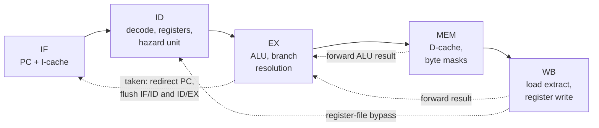
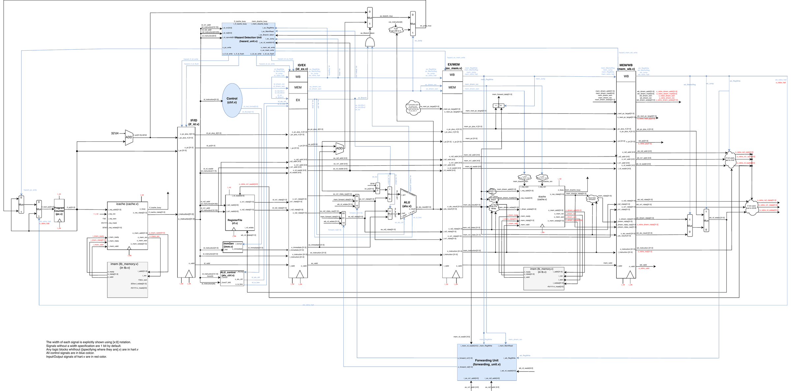
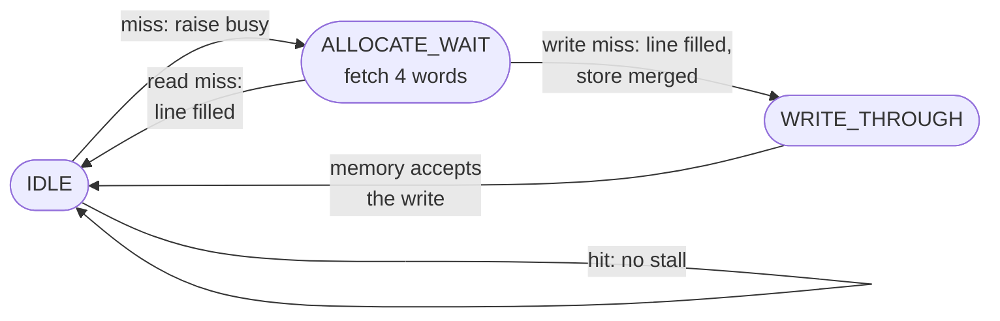
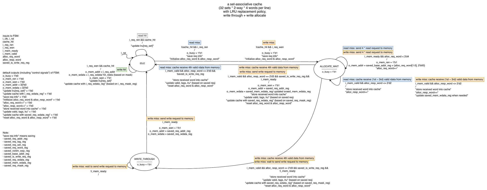
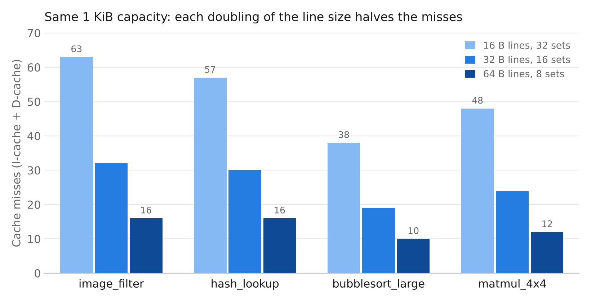

# Five-Stage Pipelined RISC-V Processor with Caches

Course project for CS/ECE 552 Introduction to Computer Architecture at UW-Madison, Fall 2025.
Built by Botao Rui, Jianing Ou and David Wu.

This page covers the design, the diagrams and the measured results.
The source code stays private because this is a course project.

## At a glance

| Part | Design |
|---|---|
| ISA | WISC-F25, a subset of RV32I (R, I, S, B, U and J types, byte and half-word loads and stores) |
| Pipeline | 5 stages (IF, ID, EX, MEM, WB), in order |
| Data hazards | Forwarding into EX, register-file bypass, 1-cycle stall only for load-use |
| Control hazards | Predict not taken, resolved in EX, 2-cycle penalty on a taken branch or jump |
| Caches | Separate I-cache and D-cache, 1 KiB each, 2-way, 16 B lines, LRU, write-through, write-allocate |
| Memory model | Word-wide, 4-cycle latency, accepts a new request every 2 cycles |
| Verification | All course accuracy tests passed. Four benchmark programs for CPI and miss counts |
| Hardware | FPGA demos on Intel Cyclone boards. The Project 5 pipeline was also synthesized in a 32 nm standard-cell library and met timing at a 7.0 ns clock |
| Extensions | Miss-counting testbench, next-line prefetcher, line-size study, 2-bit branch predictor |

## Pipeline

| Hazard | How it is handled | Cost |
|---|---|---|
| An ALU result is needed by the next instruction | Forward from EX/MEM or MEM/WB into EX | 0 cycles |
| A register is written and read in the same cycle | Register-file bypass | 0 cycles |
| A load result is needed by the next instruction | Hold PC and IF/ID, insert a bubble into EX | 1 cycle |
| Taken branch or jump | Flush the two younger instructions, fetch the target | 2 cycles |
| I-cache miss | Hold fetch and feed bubbles into ID | until the line is filled |
| D-cache miss | Freeze the whole pipeline | until the line is filled |

The hazard unit only stalls when the instruction in ID really reads the register, so stores, branches and immediates do not stall on registers they do not use.
When several events happen in one cycle, a D-cache miss wins, then a branch flush, then an I-cache miss, then a load-use stall.

Full schematic of the pipeline with both caches

## Caches

| Parameter | Value |
|---|---|
| Capacity | 1 KiB per cache |
| Organization | 2-way set associative, 32 sets |
| Line | 16 B (4 words) |
| Address split | 23-bit tag, 5-bit index, 4-bit offset |
| Replacement | LRU, one bit per set |
| Writes | Write-through, write-allocate |

Three choices shaped the timing:

1. **Hits are free.** A read hit returns data in the same cycle. A write hit updates the line and sends the write-through to memory without stalling the pipeline.
2. **Line fills are pipelined.** The memory accepts a new request before the previous one returns, so the cache sends the next word's request while earlier ones are still in flight.
3. **Write misses allocate first.** The cache fills the line, merges the store's bytes, and then writes the word through.

Full cache state machine

## How misses were measured

The cache raises its busy signal on a miss and keeps it high until the miss is served.
The testbench counts the rising edges of busy, separately for the I-cache and the D-cache, so a long miss is counted once.

## Experiment 1: line size and the 3 Cs

Before changing the cache, we checked which kind of miss each benchmark had.
All four data sets are 128 to 256 B, far below the 1 KiB capacity, so capacity misses were unlikely.
Each array also mapped to its own sets, so conflict misses were unlikely.
That left cold misses, which larger lines should reduce.

We kept the capacity and the 2 ways fixed and traded sets for line size.

| Total misses | image_filter | hash_lookup | bubblesort_large | matmul_4x4 |
|---|---:|---:|---:|---:|
| 16 B lines, 32 sets | 63 | 57 | 38 | 48 |
| 32 B lines, 16 sets | 32 | 30 | 19 | 24 |
| 64 B lines, 8 sets | 16 | 16 | 10 | 12 |
| Change, 16 B to 64 B | −75% | −72% | −74% | −75% |

The numbers confirm the diagnosis.
Each doubling of the line size halved the misses, even though the number of sets also halved.
If conflict misses had mattered, fewer sets would have added misses.

**Fewer misses did not mean a faster processor.**

| CPI | image_filter | hash_lookup | bubblesort_large | matmul_4x4 |
|---|---:|---:|---:|---:|
| 16 B lines (baseline) | 1.393 | 1.771 | 1.558 | 1.495 |
| 32 B lines | 1.395 | 1.716 | 1.565 | 1.496 |
| 64 B lines | 1.394 | 1.688 | 1.561 | 1.494 |

A bigger line moves more data on every miss.
With this memory model, filling a 64 B line takes about 34 cycles, compared with about 10 cycles for a 16 B line.
So the processor saw fewer stalls, but each one was longer.
CPI changed by less than 0.2% on three benchmarks.
Only hash_lookup improved, by 4.7%. It is a short program, so its cold misses are a larger share of its run time.

## Experiment 2: next-line prefetcher

After a demand miss fills line A, the cache queues a prefetch of line A + 16 B.
A fourth state, PREFETCH, fetches that line when the CPU is not using the cache.

- A prefetch is skipped if the line is already in the cache.
- A new demand miss cancels a queued prefetch, because it creates a newer target.
- A started prefetch runs to the end, so a demand access that arrives during it must wait.

| D-cache misses | image_filter | hash_lookup | bubblesort_large | matmul_4x4 |
|---|---:|---:|---:|---:|
| No prefetcher | 16 | 17 | 8 | 12 |
| Next-line prefetcher | 16 | 17 | 8 | 10 |

The prefetcher cut D-cache misses by 17% on matmul_4x4, where rows of matrix A are read in order.
It did not help the other benchmarks, and CPI got slightly worse on matmul_4x4 (1.495 to 1.496).
The waveforms showed why:

- **The I-cache never prefetched.** The pipeline fetches an instruction every cycle, so the I-cache was never idle long enough to start one.
- **D-cache prefetches were badly timed.** Many were cancelled by the next miss before they started. Others finished too late to turn a miss into a hit, or blocked a demand access while they ran.
- **The access patterns did not match.** image_filter reads neighbors 32 B away, hash_lookup starts at random buckets, and bubblesort_large already fits in 8 lines after its first pass.

A stride prefetcher, a stream buffer, or a prefetch that can be interrupted by a demand access would fit these patterns better.

## Experiment 3: 2-bit branch predictor

An 8-entry table of 2-bit saturating counters, indexed by PC bits [4:2], predicts each branch in IF.
An 8-entry branch target buffer supplies the target.
Both are updated in EX, where branches resolve.

| | image_filter | hash_lookup | bubblesort_large | matmul_4x4 |
|---|---:|---:|---:|---:|
| Accuracy, predict not taken | 97.6% | 84.3% | 73.5% | 51.6% |
| Accuracy, 2-bit predictor | 97.6% | 79.2% | 84.1% | 92.6% |
| CPI, predict not taken | 1.393 | 1.771 | 1.558 | 1.495 |
| CPI, 2-bit predictor | 1.393 | 1.787 | 1.515 | 1.300 |

The predictor helps most on long loops: matmul_4x4 CPI fell by 13%.
hash_lookup got worse, likely because its branches alias in the small table or alternate between outcomes.

## Summary of CPI

Each row below adds one change to the baseline with caches. The changes are not combined.

| CPI | image_filter | hash_lookup | bubblesort_large | matmul_4x4 |
|---|---:|---:|---:|---:|
| Ideal memory, no cache (Project 5) | 1.381 | 1.421 | 1.497 | 1.470 |
| With caches (baseline) | 1.393 | 1.771 | 1.558 | 1.495 |
| Baseline + next-line prefetcher | 1.395 | 1.771 | 1.566 | 1.496 |
| Baseline + 64 B lines | 1.394 | 1.688 | 1.561 | 1.494 |
| Baseline + 2-bit branch predictor | 1.393 | 1.787 | 1.515 | 1.300 |

## What we learned

- **Classify misses before optimizing.** The 3 Cs check showed there were no conflict misses, so more ways would have added complexity for no gain.
- **Miss count is not the whole cost.** How much data each miss moves sets the stall time. A larger line cut misses by 75% but made each one about 3 times longer.
- **A correct prefetch can still be useless.** It only helps if it starts while the cache is idle and finishes before the CPU asks for the line. A blocking prefetcher on a cache that is busy every cycle never gets that chance.
